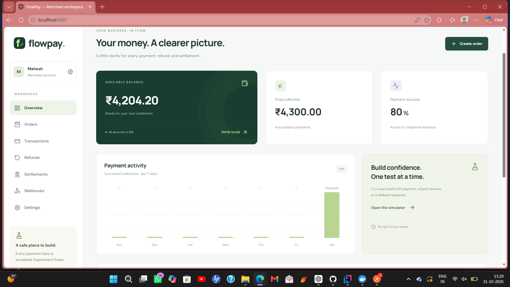
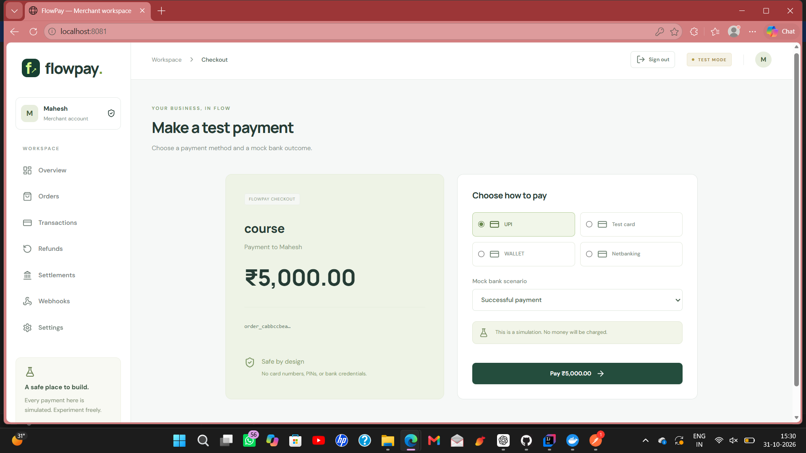
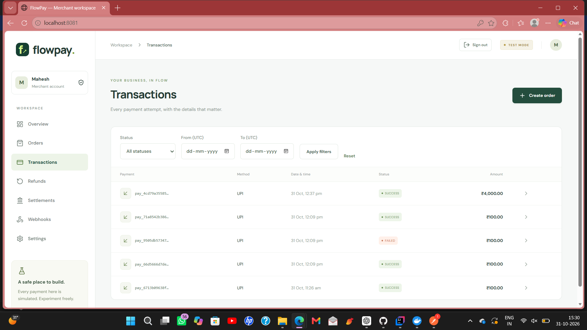
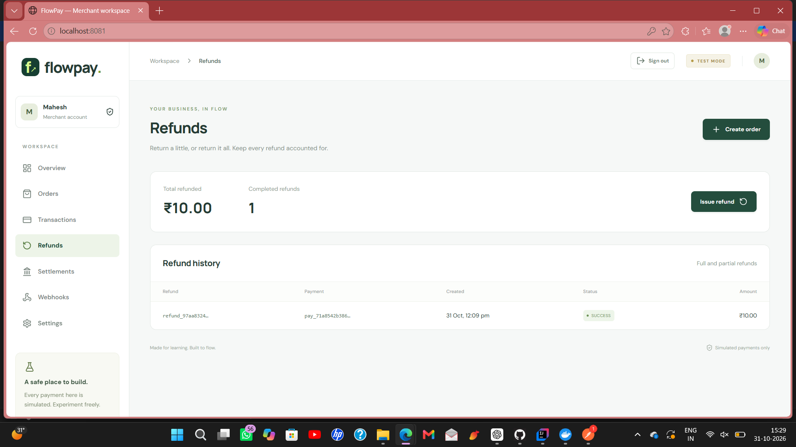
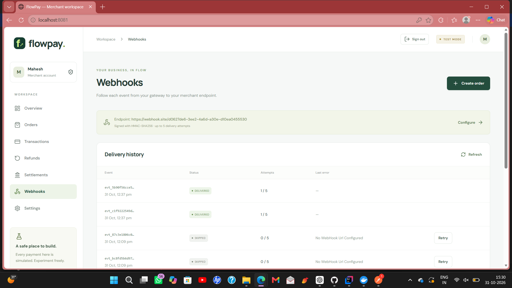
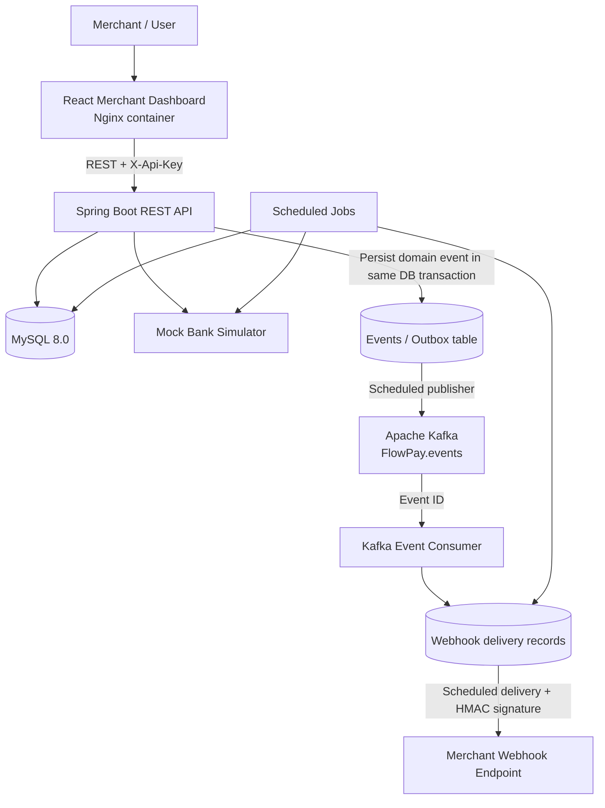
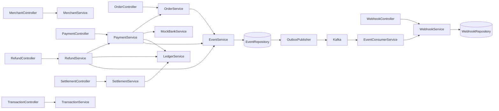
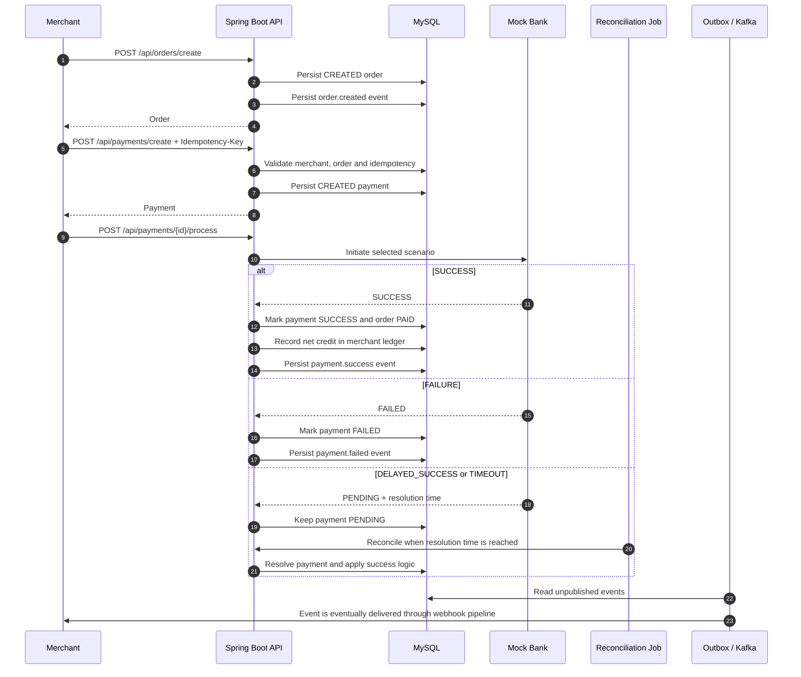
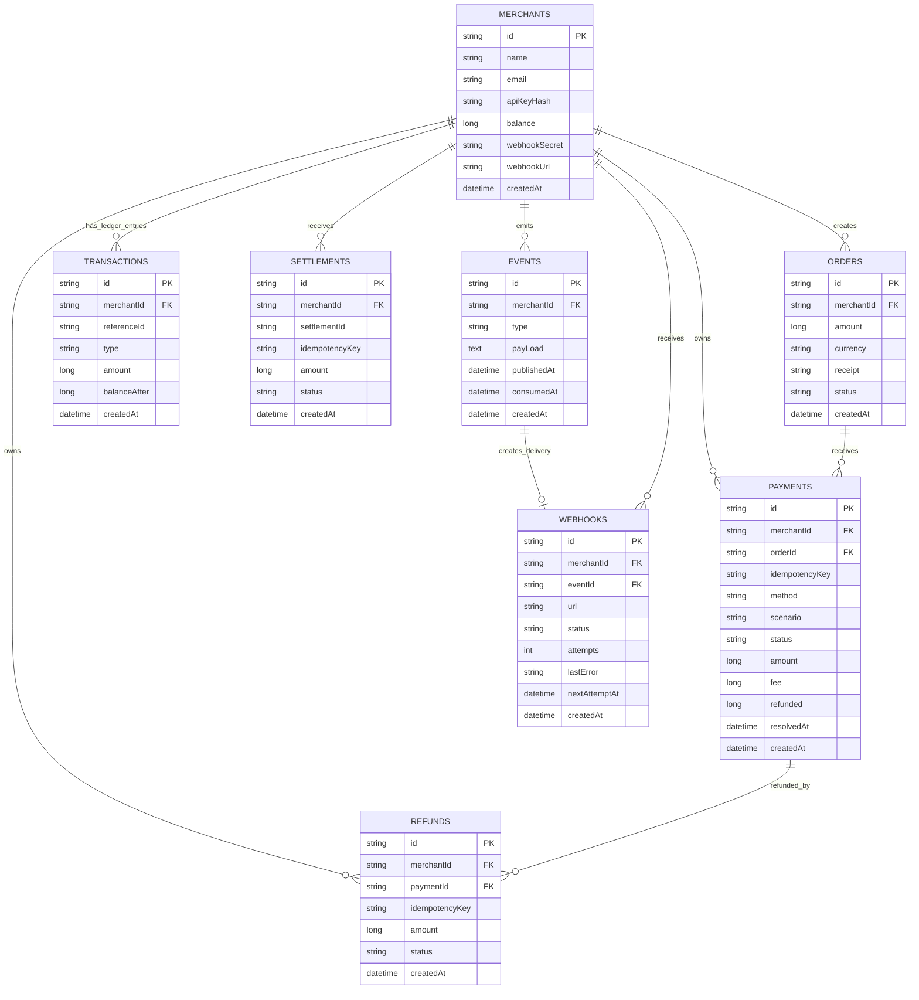

# FlowPay — Full-Stack Payment Gateway Simulation

<p align="center">
  <strong>A full-stack payment gateway simulation built with Spring Boot, React, MySQL, Kafka and Docker.</strong>
</p>

<p align="center">
  <a href="https://github.com/MoreVikrant/FlowPay">GitHub Repository</a> ·
  <a href="#getting-started">Run Locally</a> ·
  <a href="#api-reference">API Reference</a> ·
  <a href="#architecture">Architecture</a>
</p>

> **Project status:** Local development / demonstration project. FlowPay simulates payment processing through a mock bank; it does not connect to real banking networks, move real money, or process live card credentials.

---

## About

FlowPay is a full-stack payment gateway simulation designed to demonstrate the backend workflows and engineering concepts behind a payment platform. It provides a merchant workspace to create orders, initiate simulated payments, inspect transactions, issue refunds, track settlements and configure webhook delivery.

The backend is built with **Java 21 and Spring Boot** and exposes REST APIs secured with merchant API keys. **MySQL** stores merchant and payment data, while **Apache Kafka** supports asynchronous event processing. A database-backed **Transactional Outbox** records domain events in the same transaction as the business operation before a scheduled publisher sends them to Kafka. The React dashboard provides a merchant-facing interface for interacting with these workflows.

### Highlights

- Merchant registration and API-key authentication.
- Merchant-scoped access to orders, payments, refunds, settlements, ledger entries and webhook records.
- Order creation and simulated payment processing.
- Idempotency keys for payment, refund and settlement creation.
- Mock bank scenarios: success, failure, delayed success and timeout/pending.
- Scheduled reconciliation of pending simulated payments.
- Transactional Outbox event persistence and asynchronous Kafka publishing/consumption.
- HMAC-SHA256 signed webhook delivery with retry scheduling.
- Ledger entries that update the merchant's available balance for successful payments, refunds and settlements.
- React merchant dashboard and Docker Compose-based local environment.

## Product Screenshots

### Merchant overview



### Checkout simulator



### Transactions



### Refunds



### Webhook delivery history



## Technology Stack

| Area | Technology |
|---|---|
| Backend | Java 21, Spring Boot 4.1.1, Spring MVC, Spring Data JPA, Bean Validation |
| Frontend | React 19, Vite 6, JavaScript, Tailwind CSS 4, Lucide React |
| Database | MySQL 8.0 |
| Messaging | Apache Kafka (KRaft mode in the local Compose setup) |
| Persistence | Hibernate / Spring Data JPA |
| Build | Maven, npm |
| Containers | Docker, Docker Compose |
| Webhook signing | HMAC-SHA256 |

---

# Architecture

## High-Level Design (HLD)



**Request and event flow:**

1. A merchant interacts with the React dashboard or calls the REST API.
2. The backend authenticates the merchant using its API key and scopes data access to that merchant.
3. Business operations are persisted in MySQL. When an operation emits a domain event, the event is stored in the `events` table as part of the business transaction.
4. A scheduled outbox publisher sends the event ID to Kafka.
5. The Kafka consumer loads the persisted event and creates a webhook-delivery record for the merchant.
6. A scheduled webhook worker sends the event payload to the configured merchant endpoint and signs the payload with HMAC-SHA256.

## Low-Level Design (LLD)

The backend is organized by business domain rather than placing all logic in a single service.

| Package | Responsibility |
|---|---|
| `merchant` | Merchant registration, API-key authentication, profile and webhook configuration |
| `order` | Order creation and merchant-scoped order retrieval |
| `payment` | Payment creation, idempotency, processing and reconciliation |
| `bank` | Mock bank outcomes and scheduled completion of pending payments |
| `refund` | Full/partial refund validation, fee reversal and ledger adjustment |
| `settlement` | Settlement creation and transfer of available balance out of the merchant balance |
| `transaction` | Payment transaction queries and merchant ledger operations |
| `kafka` | Domain event persistence, outbox publishing and event consumption |
| `webhook` | Webhook delivery, signature generation, retries and delivery history |
| `common` | Shared entities, ID generation, idempotency validation and exception handling |

### Main service relationships



## Payment lifecycle



### Mock bank scenarios

| Scenario | Initial result from processing | Simulator behavior |
|---|---|---|
| `SUCCESS` | `SUCCESS` | Payment succeeds immediately. |
| `FAILURE` | `FAILED` | Payment fails immediately. |
| `DELAYED_SUCCESS` | `PENDING` | Becomes eligible for reconciliation after approximately 8 seconds. |
| `TIMEOUT` | `PENDING` | Becomes eligible for reconciliation after approximately 20 seconds. In this simulator, the later check resolves it to `SUCCESS`; it is not a permanent failure. |

The bank job runs every 2 seconds and processes up to 50 due payments per scenario in each run. Timing is approximate because it depends on scheduler execution.

## Transactional Outbox and Kafka

FlowPay does not rely on a direct database-write-then-Kafka-publish sequence inside the request path. The application first persists a domain event in the MySQL `events` table as part of the business transaction. A scheduled publisher then:

1. Selects unpublished events (up to 50 per run, oldest first).
2. Locks the event row and skips it if it is already marked as published.
3. Sends the event ID to the Kafka topic `FlowPay.events`, using the merchant ID as the Kafka key.
4. Sets `publishedAt` after the Kafka send completes successfully.

The Kafka consumer receives the event ID, loads the event from MySQL and creates a webhook-delivery record. The consumer checks `consumedAt` to avoid creating the same delivery record again after a repeated event. The Kafka topic is configured with 3 partitions and 1 replica in this project.

**Delivery semantics:** The outbox closes the database-commit / event-publication gap by persisting the event with the business operation. The publisher and consumer are designed to tolerate repeat processing through persisted state checks. This should not be described as end-to-end exactly-once delivery; a send can be repeated around a crash boundary, so downstream processing should remain idempotent.

## Webhook delivery

- Merchants configure a webhook URL through `PUT /api/merchants/me`.
- The event payload is JSON and includes event ID, type, merchant ID, reference ID, amount, currency and creation time.
- Delivery includes `X-FlowPay-Event` and `X-FlowPay-Signature` headers.
- The signature is an HMAC-SHA256 hex digest of the exact JSON payload, using the merchant's webhook secret.
- The worker checks pending deliveries every 2 seconds and selects up to 50 due records per run.
- A delivery is marked `DELIVERED` for a 2xx response. Failed attempts are rescheduled with exponential delay (`2^attempts` seconds); automatic delivery stops after 5 attempts and the record becomes `FAILED`.
- A merchant can manually retry an eligible non-delivered webhook using the retry endpoint. A retry requires a configured webhook URL and resets the attempt counter.
- If no webhook URL is configured when the event is consumed, the delivery record is marked `SKIPPED`.

### Webhook signature verification example (Node.js)

```javascript
import crypto from "node:crypto";

export function verifyFlowPayWebhook(rawBody, signature, webhookSecret) {
  const expected = crypto
    .createHmac("sha256", webhookSecret)
    .update(rawBody)
    .digest("hex");

  const received = Buffer.from(signature || "", "utf8");
  const calculated = Buffer.from(expected, "utf8");

  return received.length === calculated.length &&
    crypto.timingSafeEqual(received, calculated);
}
```

Verify against the **raw request body bytes/string**, before parsing and re-serializing JSON. Store the webhook secret securely; do not expose it in client-side code or commit it to source control.

## Idempotency

Payment, refund and settlement creation require an `Idempotency-Key` header. The backend validates that the key contains 8–100 characters from letters, digits, underscores and hyphens.

- Payment uniqueness is enforced for `(merchantId, idempotencyKey)`.
- Refund uniqueness is enforced for `(merchantId, idempotencyKey)`.
- Settlement uniqueness is enforced for `(merchantId, idempotencyKey)`.
- For payment and refund requests, a repeated key with a different request payload is rejected rather than silently returning an unrelated result.
- For settlement, a repeated key returns the existing settlement.

The dashboard generates UUID-based idempotency keys for its create actions. API clients should reuse the same key when retrying the same logical operation after a timeout.

## Ledger, refunds and settlements

FlowPay stores monetary amounts as integer **paise** to avoid floating-point arithmetic in payment calculations. The API examples below therefore use integer amounts: `500000` represents ₹5,000.00.

- On successful payment, the merchant receives a ledger credit equal to `payment amount - fee`.
- The current fee function calculates approximately 2% of the payment amount, rounded up to the next paise.
- A refund can only be created for a successful payment and cannot exceed the remaining refundable amount.
- Partial refunds return the proportional part of the original fee based on cumulative refunded amount. The merchant ledger is debited by the refund amount less the fee returned.
- Settlement creates a record for the merchant's current available balance and records an equal negative ledger entry, bringing the available balance down by that amount.
- Every ledger entry stores its reference, type, signed amount and resulting `balanceAfter`.

This is a project ledger simulation, not a bank-grade double-entry accounting system or a real funds-transfer rail.

## Database design

The following diagram reflects the entity classes in the supplied backend source. IDs and timestamps are inherited from the shared base entity. Relationships are represented by stored IDs in the entity fields; the model does not define JPA object relationships for every connection.



**Important:** `transactions` is the table name used by the `LedgerEntry` entity; it stores ledger entries, while the transaction listing API returns payment records. The diagram shows logical references based on ID fields, not necessarily database-enforced foreign-key constraints.

---

# API Reference

**Base URL (local):** `http://localhost:8080`

Most endpoints require the merchant API key in the `X-Api-Key` header. The registration endpoint is public and returns the API key and webhook secret. Payment, refund and settlement creation additionally require an `Idempotency-Key` header.

## Authentication headers

```http
X-Api-Key: <merchant_api_key>
Idempotency-Key: <unique-key-for-this-operation>
Content-Type: application/json
```

Header casing is not significant in HTTP. The backend source uses `X-API-Key` in the merchant controller and `X-Api-Key` in other controllers.

## Endpoint summary

| Domain | Method | Endpoint | Authentication | Purpose |
|---|---|---|---|---|
| Merchant | `POST` | `/api/merchants` | Public | Register a merchant |
| Merchant | `GET` | `/api/merchants/me` | API key | Get authenticated merchant |
| Merchant | `PUT` | `/api/merchants/me` | API key | Update merchant profile and webhook URL |
| Orders | `POST` | `/api/orders/create` | API key | Create an order |
| Orders | `GET` | `/api/orders` | API key | List merchant orders |
| Orders | `GET` | `/api/orders/{id}` | API key | Get one merchant order |
| Payments | `POST` | `/api/payments/create` | API key + idempotency | Create a payment attempt |
| Payments | `GET` | `/api/payments/{id}` | API key | Get payment details |
| Payments | `POST` | `/api/payments/{id}/process` | API key | Process payment through mock bank |
| Payments | `POST` | `/api/payments/{id}/check` | API key | Reconcile/check a pending payment |
| Refunds | `POST` | `/api/refunds/create` | API key + idempotency | Create full or partial refund |
| Refunds | `GET` | `/api/refunds` | API key | List merchant refunds |
| Settlements | `POST` | `/api/settlements/create` | API key + idempotency | Settle available merchant balance |
| Settlements | `GET` | `/api/settlements` | API key | List merchant settlements |
| Transactions | `GET` | `/api/transactions/list` | API key | List/filter payment attempts |
| Transactions | `GET` | `/api/transactions/{id}` | API key | Get payment details |
| Ledger | `GET` | `/api/transactions/ledger` | API key | List merchant ledger entries |
| Webhooks | `GET` | `/api/webhooks` | API key | List webhook delivery records |
| Webhooks | `POST` | `/api/webhooks/{id}/retry` | API key | Retry a webhook delivery |
| Health | `GET` | `/actuator/health` | Public in default config | Spring Boot health endpoint |

## Merchant APIs

### Register merchant

`POST /api/merchants`

No API key is required.

```bash
curl -X POST http://localhost:8080/api/merchants \
  -H "Content-Type: application/json" \
  -d '{
    "name": "Acme Store",
    "email": "payments@example.com"
  }'
```

Request fields:

| Field | Type | Validation |
|---|---|---|
| `name` | string | Required, maximum 100 characters |
| `email` | string | Required, valid email, maximum 100 characters |

The response contains a `merchant` object, `apiKey` and `webhookSecret`. Save both secrets when registering; the API key is used for subsequent API requests and the webhook secret is used to verify webhook signatures. Treat the response as sensitive.

### Get current merchant

`GET /api/merchants/me`

```bash
curl http://localhost:8080/api/merchants/me \
  -H "X-Api-Key: YOUR_API_KEY"
```

### Update merchant and configure webhook

`PUT /api/merchants/me`

```bash
curl -X PUT http://localhost:8080/api/merchants/me \
  -H "X-Api-Key: YOUR_API_KEY" \
  -H "Content-Type: application/json" \
  -d '{
    "name": "Acme Store",
    "email": "payments@example.com",
    "webhookUrl": "http://localhost:9000/webhooks/flowpay"
  }'
```

`name` and `email` are required. `webhookUrl` may be null/blank to leave no destination configured. Nonblank URLs must use HTTP or HTTPS and their host must be present in the backend `app.webhook-hosts` allowlist (`WEBHOOK_HOSTS`). User-info and URL fragments are rejected. The supplied local configuration defaults to `localhost,127.0.0.1,backend`; configure this deliberately for your environment.

## Order APIs

### Create order

`POST /api/orders/create`

```bash
curl -X POST http://localhost:8080/api/orders/create \
  -H "X-Api-Key: YOUR_API_KEY" \
  -H "Content-Type: application/json" \
  -d '{
    "amount": 500000,
    "receipt": "course-order-001"
  }'
```

| Field | Type | Validation |
|---|---|---|
| `amount` | integer | Minimum 100 paise, maximum 10,000,000 paise |
| `receipt` | string | Required, maximum 100 characters |

The order currency defaults to `INR` and its initial status is `CREATED`. Creating an order persists an `order.created` event.

### List orders

`GET /api/orders`

### Get order

`GET /api/orders/{id}`

Both endpoints require `X-Api-Key` and return only records belonging to the authenticated merchant. A record belonging to another merchant is treated as not found.

## Payment APIs

### Create payment

`POST /api/payments/create`

Requires both `X-Api-Key` and `Idempotency-Key`.

```bash
curl -X POST http://localhost:8080/api/payments/create \
  -H "X-Api-Key: YOUR_API_KEY" \
  -H "Idempotency-Key: payment-course-0001" \
  -H "Content-Type: application/json" \
  -d '{
    "orderId": "ORDER_ID_FROM_CREATE_ORDER",
    "method": "UPI",
    "scenario": "SUCCESS"
  }'
```

| Field | Allowed values / validation |
|---|---|
| `orderId` | Required order ID owned by the merchant |
| `method` | `CARD`, `UPI`, `NETBANKING`, `WALLET` |
| `scenario` | `SUCCESS`, `FAILURE`, `TIMEOUT`, `DELAYED_SUCCESS` |

The payment amount is taken from the existing order; the client does not submit a payment amount. The backend rejects an order that is already paid or has an active `SUCCESS`/`PENDING` payment. A repeated idempotency key with the same order, method and scenario returns the existing payment. Reusing the key with different values is rejected.

### Process payment

`POST /api/payments/{id}/process`

```bash
curl -X POST http://localhost:8080/api/payments/PAYMENT_ID/process \
  -H "X-Api-Key: YOUR_API_KEY"
```

A payment in `CREATED` state is sent to the mock bank simulator. Calling process again after the payment has left `CREATED` returns its current record without processing it again.

### Get payment / check pending payment

```bash
curl http://localhost:8080/api/payments/PAYMENT_ID \
  -H "X-Api-Key: YOUR_API_KEY"

curl -X POST http://localhost:8080/api/payments/PAYMENT_ID/check \
  -H "X-Api-Key: YOUR_API_KEY"
```

The check endpoint reconciles a payment only when its current status is `PENDING`. The scheduled reconciliation job also checks due delayed payments automatically.

## Refund APIs

### Create refund

`POST /api/refunds/create`

```bash
curl -X POST http://localhost:8080/api/refunds/create \
  -H "X-Api-Key: YOUR_API_KEY" \
  -H "Idempotency-Key: refund-course-0001" \
  -H "Content-Type: application/json" \
  -d '{
    "paymentId": "SUCCESSFUL_PAYMENT_ID",
    "amount": 10000
  }'
```

| Field | Type | Validation |
|---|---|---|
| `paymentId` | string | Required successful payment owned by merchant |
| `amount` | integer | Minimum 1 paise, maximum 100,000,000 paise; must not exceed remaining refundable amount |

Refunds can be partial or full. A refund is recorded with status `SUCCESS` by the current simulator. The operation updates the payment's cumulative refunded amount, applies the fee reversal calculation and records a negative ledger adjustment. It emits a `refund.created` event.

### List refunds

`GET /api/refunds`

Returns the authenticated merchant's refunds, newest first.

## Settlement APIs

### Create settlement

`POST /api/settlements/create`

Requires `X-Api-Key` and `Idempotency-Key`. No request body is required.

```bash
curl -X POST http://localhost:8080/api/settlements/create \
  -H "X-Api-Key: YOUR_API_KEY" \
  -H "Idempotency-Key: settlement-course-0001"
```

The service creates a settlement for the merchant's full available balance. If the balance is zero or negative, the request is rejected. Repeating the same idempotency key returns the existing settlement.

### List settlements

`GET /api/settlements`

## Transaction and ledger APIs

### List transactions (payment attempts)

`GET /api/transactions/list`

Optional query parameters:

| Parameter | Meaning |
|---|---|
| `status` | Exact payment status filter |
| `from` | Inclusive start date, `YYYY-MM-DD` (UTC) |
| `to` | Inclusive end date, `YYYY-MM-DD` (UTC) |

```bash
curl "http://localhost:8080/api/transactions/list?status=SUCCESS&from=2026-10-01&to=2026-10-31" \
  -H "X-Api-Key: YOUR_API_KEY"
```

If both dates are supplied, `from` must not be after `to`. The `to` date includes the full UTC day. This endpoint returns payment records, not ledger rows.

### Get transaction details

`GET /api/transactions/{id}`

Returns the payment record for the given ID, scoped to the authenticated merchant.

### List ledger entries

`GET /api/transactions/ledger`

```bash
curl http://localhost:8080/api/transactions/ledger \
  -H "X-Api-Key: YOUR_API_KEY"
```

Ledger records include `referenceId`, `type`, signed `amount` and `balanceAfter`.

## Webhook APIs

### List webhook deliveries

`GET /api/webhooks`

Returns the authenticated merchant's webhook delivery history, including status, attempt count and last error.

### Retry webhook delivery

`POST /api/webhooks/{id}/retry`

```bash
curl -X POST http://localhost:8080/api/webhooks/WEBHOOK_RECORD_ID/retry \
  -H "X-Api-Key: YOUR_API_KEY"
```

A delivered webhook cannot be retried. The merchant must have a webhook URL configured. A retry resets the attempt counter and schedules the record for immediate delivery.

## Common response statuses and errors

The API returns JSON error bodies in the form:

```json
{
  "message": "A descriptive error message"
}
```

The shared exception handler maps business exceptions to their configured HTTP status, validation/malformed JSON/missing required header errors to `400`, and database uniqueness conflicts to `409`. Invalid or missing merchant API keys return `401`. Merchant-scoped lookups for records not owned by the caller return not found.

Typical cases:

| HTTP status | Meaning / example |
|---|---|
| `200` | Successful retrieval or operation |
| `201` | Merchant, order, payment or refund created |
| `400` | Invalid input, missing required header or malformed request |
| `401` | Missing or invalid API key |
| `404` | Record not found or belongs to another merchant |
| `409` | Duplicate/conflicting operation, insufficient balance or idempotency conflict |

The exact response status for each business error follows the exception raised by that service; use the returned `message` as the diagnostic detail.

---

# Getting Started

## Prerequisites

- Docker Desktop with Docker Compose support.
- Git.
- A free local port `8080` for the backend, `8081` for the frontend, `3307` for the host-side MySQL mapping and `9092` for Kafka.

You do not need to install Java, Maven, Node.js or MySQL locally to run the complete stack through Docker Compose. The backend image builds with Maven and Java 21; the frontend image builds and serves the React app through Nginx.

## 1. Clone the repository

```bash
git clone https://github.com/MoreVikrant/FlowPay.git
cd FlowPay
```

## 2. Configure environment variables

Create a `.env` file in the repository root. Do not commit this file.

```env
MYSQL_USER=flowpay
MYSQL_PASSWORD=change_this_password
MYSQL_ROOT_PASSWORD=change_this_root_password
FRONTEND_PORT=8081
```

Use strong, unique values for local credentials. The Compose file passes the database credentials to the MySQL and backend containers.

## 3. Build and start the application

```bash
docker compose up --build -d
```

Check container status:

```bash
docker compose ps
```

Follow logs:

```bash
docker compose logs -f backend
docker compose logs -f frontend
docker compose logs -f kafka
```

## 4. Open FlowPay

| Component | Local address |
|---|---|
| React merchant dashboard | http://localhost:8081 |
| Spring Boot API | http://localhost:8080 |
| Health endpoint | http://localhost:8080/actuator/health |
| MySQL host port | `localhost:3307` |
| Kafka host port | `localhost:9092` |

Open the dashboard and register a merchant to receive a test API key. Use the dashboard to create orders and simulate payment outcomes.

## 5. Stop the application

```bash
docker compose down
```

To remove the MySQL named volume and its persisted local database as well:

```bash
docker compose down -v
```

> `docker compose down -v` permanently deletes the local MySQL data volume. Use it only when you intend to reset the demo database.

---

# Configuration

The backend reads the following environment variables / Spring properties.

| Variable / property | Default or Compose value | Purpose |
|---|---|---|
| `DB_URL` | Local default in `application.properties`; Compose uses `jdbc:mysql://mysql:3306/FlowPay...` | JDBC connection URL |
| `DB_USER` | `root` in local property fallback; Compose uses `MYSQL_USER` | Database username |
| `DB_PASSWORD` | `root` in local property fallback; Compose uses `MYSQL_PASSWORD` | Database password |
| `KAFKA_SERVERS` | `127.0.0.1:9092`; Compose uses `kafka:9092` | Kafka bootstrap server |
| `DEMO_ENABLED` | `true` in property fallback; Compose sets `false` | Demo-mode application flag |
| `WEBHOOK_HOSTS` | `localhost,127.0.0.1,backend` | Comma-separated webhook destination host allowlist |
| `app.jobs-enabled` | `true` | Enables scheduled bank reconciliation, outbox and webhook jobs |
| `app.kafka-enabled` | `true` | Enables Kafka-related configuration and processing |

Additional configuration in the supplied properties:

- Hibernate schema mode is `update`.
- Hibernate JDBC timezone is UTC.
- Spring Actuator exposes `health` and `info`.
- Kafka consumer group ID is `flowpay-webhooks`.
- Kafka consumer auto-commit is disabled and listener acknowledgement mode is `record`.

**Production hardening note:** The checked-in development properties contain fallback database credentials and permissive local defaults. Replace these with externally managed secrets for any shared environment. Review Hibernate schema management, actuator exposure, TLS, database access, Kafka security, webhook allowlists and operational monitoring before any production use.

---

# Testing and Verification

The project has been exercised locally through Docker Compose and API smoke-test workflows. The validated demonstration flows include:

1. **Successful payment:** register merchant → create order → create payment with `SUCCESS` → process payment → verify payment status, merchant balance and ledger entry.
2. **Failed and pending payment behavior:** create payments using `FAILURE`, `DELAYED_SUCCESS` and `TIMEOUT` scenarios → process → observe immediate failure or pending state → verify scheduled reconciliation for pending scenarios.
3. **Refund and settlement:** refund a successful payment (including a partial amount) → inspect refund and ledger history → create settlement → verify settlement record and updated available balance.
4. **Webhook delivery:** configure a reachable webhook endpoint → trigger an event → inspect webhook history and delivery status; failed deliveries can be retried.

The source archive supplied for this README did not include a committed automated test suite or the smoke-test script itself. Therefore, these are documented as manually validated/API smoke-test workflows, not as a claim of a passing automated CI test suite. Add the actual test script and its exact command here when it is committed to the repository.

Useful runtime checks:

```bash
# Service health
curl http://localhost:8080/actuator/health

# Container status
docker compose ps

# Backend logs
docker compose logs --tail=200 backend
```

---

# Repository Structure

The repository uses a Maven backend and a separate React frontend. The key application areas are:

```text
FlowPay/
├── src/main/java/com/FlowPay/
│   ├── bank/          # Mock bank and scheduled reconciliation
│   ├── common/        # Shared entities, IDs, idempotency and errors
│   ├── kafka/         # Event store, outbox publisher and consumer
│   ├── merchant/      # Merchant registration and authentication
│   ├── order/         # Order domain
│   ├── payment/       # Payment lifecycle
│   ├── refund/        # Refund processing
│   ├── settlement/    # Merchant settlements
│   ├── transaction/   # Payment queries and ledger
│   └── webhook/       # Webhook delivery and retries
├── src/main/resources/
│   └── application.properties
├── frontend/
│   ├── src/           # React application and API client
│   ├── Dockerfile
│   └── nginx.conf
├── Dockerfile
├── compose.yaml
├── pom.xml
└── README.md
```

The paths above describe the intended Maven-style repository layout used by the Docker build (`src/` and `pom.xml` at the repository root). Keep the actual tracked project tree aligned with the Dockerfile and Compose build contexts.

---

# Security and Project Scope

FlowPay is intended for learning, demonstration and portfolio review. It is not a certified or production-ready payment processor.

- The bank is simulated; no real payment network, card acquirer, UPI rail or bank account is contacted.
- Do not enter real card numbers, PINs, CVVs, banking passwords or other financial credentials.
- Merchant API keys are stored as SHA-256 hashes in the backend; the generated key is returned at registration.
- Merchant webhook secrets are used for HMAC-SHA256 signatures. Protect them as credentials.
- The backend checks merchant ownership for resource retrieval and operations.
- Webhook destinations are restricted by a configurable host allowlist. Configure the allowlist carefully; do not allow arbitrary destinations in an exposed environment.
- The local Compose Kafka setup uses plaintext communication and a single broker. It is for local development, not a production Kafka cluster.
- The database uses Hibernate `ddl-auto=update` in the supplied configuration; production systems should use controlled schema migrations.
- The ledger is a simplified merchant-balance ledger, not a complete double-entry accounting implementation.

# Future Improvements

Potential next steps for the project include:

- Add automated unit, integration and end-to-end tests to the repository and run them in CI.
- Add API documentation generation (for example, OpenAPI/Swagger) from the actual controller contracts.
- Add database migrations and explicit foreign-key/index review.
- Add structured observability: correlation IDs, metrics, tracing and dashboards.
- Add authentication rate limiting, key rotation and merchant credential revocation.
- Add webhook delivery observability, dead-letter handling and configurable retry policies.
- Add Kafka broker security and multi-broker deployment configuration.
- Add a formal double-entry ledger and reconciliation reports.
- Deploy a public demo with managed database and messaging infrastructure after security hardening.

# Author

**Vikrant More** — Java Full-Stack Developer

- GitHub: [MoreVikrant](https://github.com/MoreVikrant)
- Project: [FlowPay](https://github.com/MoreVikrant/FlowPay)

---

<p align="center"><strong>FlowPay — A safe place to build. Every payment here is simulated.</strong></p>
