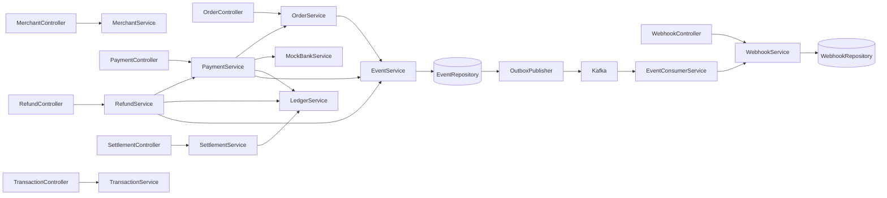
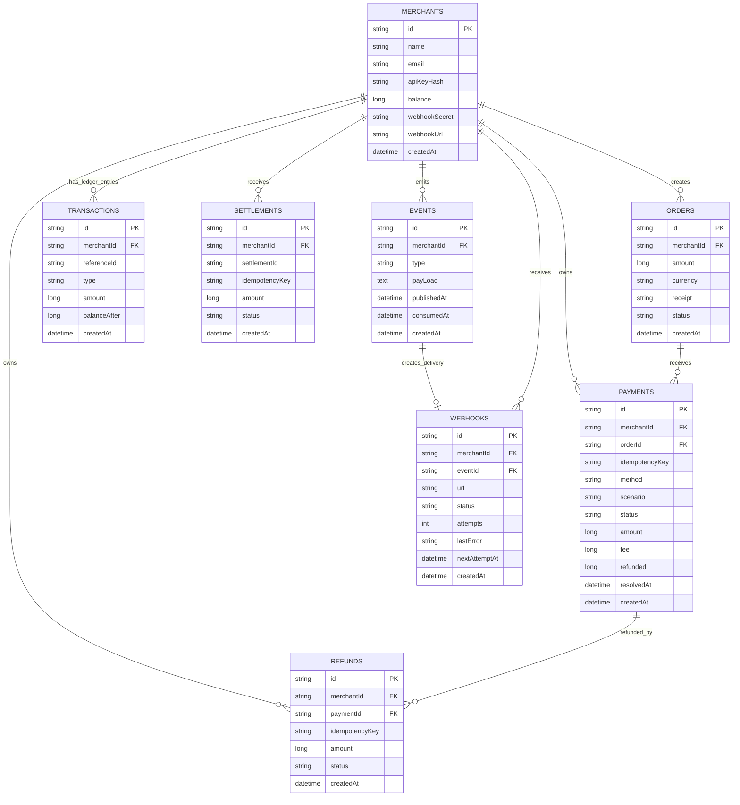

# FlowPay — Full-Stack Payment Gateway

<p align="center">
  <strong>A full-stack payment gateway simulation built with Spring Boot, React, MySQL, Kafka and Docker.</strong>
</p>

<p align="center">
  <a href="https://github.com/MoreVikrant/FlowPay">GitHub Repository</a> ·
  <a href="API_Docs.md">API Docs</a> ·
  <a href="#architecture">Architecture</a>
</p>

> **Project status:**  FlowPay simulates payment processing through a mock bank; it does not connect to real banking networks, move real money, or process live card credentials.

---

## About

FlowPay is a full-stack payment gateway simulation designed to demonstrate the backend workflows and engineering concepts behind a payment platform. It provides a merchant workspace to create orders, initiate simulated payments, inspect transactions, issue refunds, track settlements and configure webhook delivery.

The backend is built with **Java 21 and Spring Boot** and exposes REST APIs secured with merchant API keys. **MySQL** stores merchant and payment data, while **Apache Kafka** supports asynchronous event processing. A database-backed **Transactional Outbox** records domain events in the same transaction as the business operation before a scheduled publisher sends them to Kafka. The React dashboard provides a merchant-facing interface for interacting with these workflows.

### Highlights

- Merchant registration and API-key authentication.
- Merchant-scoped access to orders, payments, refunds, settlements, ledger entries and webhook records.
- Order creation and simulated payment processing.
- Idempotency keys for payment, refund and settlement creation.
- Mock bank scenarios: success, failure, delayed success and timeout/pending.
- Scheduled reconciliation of pending simulated payments.
- Transactional Outbox event persistence and asynchronous Kafka publishing/consumption.
- HMAC-SHA256 signed webhook delivery with retry scheduling.
- Ledger entries that update the merchant's available balance for successful payments, refunds and settlements.
- React merchant dashboard and Docker Compose-based local environment.

## Product Screenshots

<table>
  <tr>
    <td align="center"><b>Merchant overview</b><br></td>
    <td align="center"><b>Checkout simulator</b><br></td>
    <td align="center"><b>Transactions</b><br></td>
  </tr>
  <tr>
    <td align="center"><b>Refunds</b><br></td>
    <td align="center"><b>Webhook delivery history</b><br></td>
    <td></td>
  </tr>
</table>

## Technology Stack

| Area | Technology |
|---|---|
| Backend | Java 21, Spring Boot 4.1.1, Spring MVC, Spring Data JPA, Bean Validation |
| Frontend | React 19, Vite 6, JavaScript, Tailwind CSS 4, Lucide React |
| Database | MySQL 8.0 |
| Messaging | Apache Kafka (KRaft mode in the local Compose setup) |
| Persistence | Hibernate / Spring Data JPA |
| Build | Maven, npm |
| Containers | Docker, Docker Compose |
| Webhook signing | HMAC-SHA256 |

---

# Architecture

## Low-Level Design (LLD)

The backend is organized by business domain rather than placing all logic in a single service.

| Package | Responsibility |
|---|---|
| `merchant` | Merchant registration, API-key authentication, profile and webhook configuration |
| `order` | Order creation and merchant-scoped order retrieval |
| `payment` | Payment creation, idempotency, processing and reconciliation |
| `bank` | Mock bank outcomes and scheduled completion of pending payments |
| `refund` | Full/partial refund validation, fee reversal and ledger adjustment |
| `settlement` | Settlement creation and transfer of available balance out of the merchant balance |
| `transaction` | Payment transaction queries and merchant ledger operations |
| `kafka` | Domain event persistence, outbox publishing and event consumption |
| `webhook` | Webhook delivery, signature generation, retries and delivery history |
| `common` | Shared entities, ID generation, idempotency validation and exception handling |

### Main service relationships



## Mock bank scenarios

| Scenario | Initial result from processing | Simulator behavior |
|---|---|---|
| `SUCCESS` | `SUCCESS` | Payment succeeds immediately. |
| `FAILURE` | `FAILED` | Payment fails immediately. |
| `DELAYED_SUCCESS` | `PENDING` | Becomes eligible for reconciliation after approximately 8 seconds. |
| `TIMEOUT` | `PENDING` | Becomes eligible for reconciliation after approximately 20 seconds. In this simulator, the later check resolves it to `SUCCESS`; it is not a permanent failure. |

The bank job runs every 2 seconds and processes up to 50 due payments per scenario in each run. Timing is approximate because it depends on scheduler execution.

## Database design

The following diagram reflects the entity classes in the supplied backend source. IDs and timestamps are inherited from the shared base entity. Relationships are represented by stored IDs in the entity fields; the model does not define JPA object relationships for every connection.



**Important:** `transactions` is the table name used by the `LedgerEntry` entity; it stores ledger entries, while the transaction listing API returns payment records. The diagram shows logical references based on ID fields, not necessarily database-enforced foreign-key constraints.

---

# Configuration

The backend reads the following environment variables / Spring properties.

| Variable / property | Default or Compose value | Purpose |
|---|---|---|
| `DB_URL` | Local default in `application.properties`; Compose uses `jdbc:mysql://mysql:3306/FlowPay...` | JDBC connection URL |
| `DB_USER` | `root` in local property fallback; Compose uses `MYSQL_USER` | Database username |
| `DB_PASSWORD` | `root` in local property fallback; Compose uses `MYSQL_PASSWORD` | Database password |
| `KAFKA_SERVERS` | `127.0.0.1:9092`; Compose uses `kafka:9092` | Kafka bootstrap server |
| `DEMO_ENABLED` | `true` in property fallback; Compose sets `false` | Demo-mode application flag |
| `WEBHOOK_HOSTS` | `localhost,127.0.0.1,backend` | Comma-separated webhook destination host allowlist |
| `app.jobs-enabled` | `true` | Enables scheduled bank reconciliation, outbox and webhook jobs |
| `app.kafka-enabled` | `true` | Enables Kafka-related configuration and processing |

Additional configuration in the supplied properties:

- Hibernate schema mode is `update`.
- Hibernate JDBC timezone is UTC.
- Spring Actuator exposes `health` and `info`.
- Kafka consumer group ID is `flowpay-webhooks`.
- Kafka consumer auto-commit is disabled and listener acknowledgement mode is `record`.

**Production hardening note:** The checked-in development properties contain fallback database credentials and permissive local defaults. Replace these with externally managed secrets for any shared environment. Review Hibernate schema management, actuator exposure, TLS, database access, Kafka security, webhook allowlists and operational monitoring before any production use.

---

# Testing and Verification

The project has been exercised locally through Docker Compose and API smoke-test workflows. The validated demonstration flows include:

1. **Successful payment:** register merchant → create order → create payment with `SUCCESS` → process payment → verify payment status, merchant balance and ledger entry.
2. **Failed and pending payment behavior:** create payments using `FAILURE`, `DELAYED_SUCCESS` and `TIMEOUT` scenarios → process → observe immediate failure or pending state → verify scheduled reconciliation for pending scenarios.
3. **Refund and settlement:** refund a successful payment (including a partial amount) → inspect refund and ledger history → create settlement → verify settlement record and updated available balance.
4. **Webhook delivery:** configure a reachable webhook endpoint → trigger an event → inspect webhook history and delivery status; failed deliveries can be retried.

The source archive supplied for this README did not include a committed automated test suite or the smoke-test script itself. Therefore, these are documented as manually validated/API smoke-test workflows, not as a claim of a passing automated CI test suite. Add the actual test script and its exact command here when it is committed to the repository.

Useful runtime checks:

```bash
# Service health
curl http://localhost:8080/actuator/health

# Container status
docker compose ps

# Backend logs
docker compose logs --tail=200 backend
```

---

# Repository Structure

The repository uses a Maven backend and a separate React frontend. The key application areas are:

```text
FlowPay/
├── src/main/java/com/FlowPay/
│   ├── bank/          # Mock bank and scheduled reconciliation
│   ├── common/        # Shared entities, IDs, idempotency and errors
│   ├── kafka/         # Event store, outbox publisher and consumer
│   ├── merchant/      # Merchant registration and authentication
│   ├── order/         # Order domain
│   ├── payment/       # Payment lifecycle
│   ├── refund/        # Refund processing
│   ├── settlement/    # Merchant settlements
│   ├── transaction/   # Payment queries and ledger
│   └── webhook/       # Webhook delivery and retries
├── src/main/resources/
│   └── application.properties
├── frontend/
│   ├── src/           # React application and API client
│   ├── Dockerfile
│   └── nginx.conf
├── Dockerfile
├── compose.yaml
├── pom.xml
└── README.md
```

The paths above describe the intended Maven-style repository layout used by the Docker build (`src/` and `pom.xml` at the repository root). Keep the actual tracked project tree aligned with the Dockerfile and Compose build contexts.

---

# Security and Project Scope

FlowPay is intended for learning, demonstration and portfolio review. It is not a certified or production-ready payment processor.

- The bank is simulated; no real payment network, card acquirer, UPI rail or bank account is contacted.
- Do not enter real card numbers, PINs, CVVs, banking passwords or other financial credentials.
- Merchant API keys are stored as SHA-256 hashes in the backend; the generated key is returned at registration.
- Merchant webhook secrets are used for HMAC-SHA256 signatures. Protect them as credentials.
- The backend checks merchant ownership for resource retrieval and operations.
- Webhook destinations are restricted by a configurable host allowlist. Configure the allowlist carefully; do not allow arbitrary destinations in an exposed environment.
- The local Compose Kafka setup uses plaintext communication and a single broker. It is for local development, not a production Kafka cluster.
- The database uses Hibernate `ddl-auto=update` in the supplied configuration; production systems should use controlled schema migrations.
- The ledger is a simplified merchant-balance ledger, not a complete double-entry accounting implementation.

# Author

**Vikrant More** — Java Full-Stack Developer

- GitHub: [MoreVikrant](https://github.com/MoreVikrant)
- Project: [FlowPay](https://github.com/MoreVikrant/FlowPay)

---

<p align="center"><strong>FlowPay — A safe place to build. Every payment here is simulated.</strong></p>
